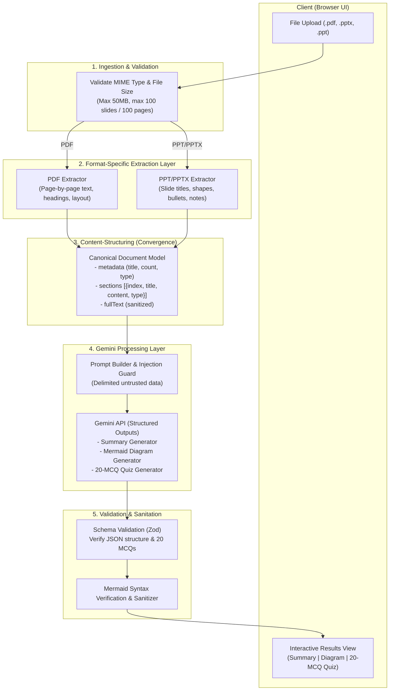

# Architecture: Unified Document-Processing Pipeline

## 1. Overview & Goals

This project provides an AI-powered study assistant for students and educators. It processes study materials—supporting both **PDF** documents and **PowerPoint (.ppt, .pptx)** presentations—into:
1. **Structured Summaries** (TL;DR, key points, slide/section breakdowns).
2. **Conceptual Visual Diagrams** (Rendered Mermaid.js diagrams).
3. **Interactive 20-Question MCQ Quizzes** (With answer keys and educational explanations).

### Core Architectural Principle: Unified Pipeline
While PDF and PPT/PPTX files have distinct binary/archive formats and extraction requirements, they converge into a single **Canonical Document Representation**. From that point forward, all downstream stages—prompt assembly, Gemini LLM calls, output validation, and frontend rendering—operate on a shared, unified pipeline.

---

## 2. Pipeline Architecture & Data Flow



---

## 3. Pipeline Stages in Detail

### Stage 1: Ingestion & File Validation
- **Input Types**: `application/pdf`, `application/vnd.ms-powerpoint`, `application/vnd.openxmlformats-officedocument.presentationml.presentation`.
- **Pre-flight Checks**:
  - Magic number / signature validation (prevent renamed malicious files).
  - Size limitation (e.g., maximum 50MB).
  - Scope boundaries (reject files exceeding ~100 slides or ~100 pages with an actionable message).

### Stage 2: Separate Extraction Components
Because PDF is page-based with arbitrary coordinate streams, and PPTX is an OpenXML archive of slides, extraction is separated into dedicated extractors:

1. **PDF Extractor**:
   - Extracts text page-by-page.
   - Extracts page count, document metadata, and structural headers.
   - Strips empty pages and extracts readable tables/paragraphs.
   - *Tools*: Python (`pypdf` / `pymupdf`) or Node (`pdfjs-dist`).

2. **PowerPoint Extractor**:
   - Parses slides sequentially.
   - Extracts slide titles, body text frames, bullet hierarchy, tables, and speaker notes.
   - Retains slide numbering for accurate citations in the summary.
   - *Tools*: Python (`python-pptx`) or Node (`jszip` + XML parser).

### Stage 3: Content-Structuring (Convergence)
Both extractors output the **Canonical Document Representation**:

```typescript
interface CanonicalDocument {
  metadata: {
    title: string;
    sourceType: 'pdf' | 'pptx' | 'ppt';
    totalUnits: number; // pages or slides
    totalWords: number;
  };
  sections: Array<{
    unitIndex: number; // page number or slide number (1-indexed)
    title?: string;
    content: string;
    notes?: string;
  }>;
  aggregatedText: string;
}
```

### Stage 4: Gemini LLM Processing Layer
- **Prompt Isolation**: Untrusted document content is passed in strictly delimited tags (`<document_content>...</document_content>`) with system instructions stating content must never be executed as instructions.
- **Structured Outputs**: Uses Gemini’s native JSON Schema mode (`response_mime_type: "application/json"`) to ensure strictly formatted responses containing:
  1. `summary`: `{ tldr: string, keyTakeaways: string[], sectionBreakdowns: [{ sectionIndex, title, summary }] }`
  2. `diagram`: `{ mermaidCode: string, diagramType: string, explanation: string }`
  3. `quiz`: Array of exactly 20 items: `[{ id, question, options: [string, string, string, string], correctIndex: number, explanation: string }]`

### Stage 5: Validation & Post-Processing
1. **Schema Validation**: Validates the payload using Zod. Ensures that `quiz` has exactly 20 valid questions with valid `correctIndex` (0–3).
2. **Mermaid Linting**: Validates that `mermaidCode` parses cleanly into valid diagram grammar (e.g. `flowchart TD` or `mindmap`) and strips risky HTML/script tags.
3. **Graceful Fallback**: If a diagram syntax error is detected, attempts a single targeted syntax correction or provides a fallback outline diagram rather than failing the entire request.

### Stage 6: Client Delivery & UI
- **Summary Tab**: Clean, modern cards for TL;DR, high-level takeaways, and expandable section details.
- **Diagram Tab**: Live-rendered SVG via Mermaid.js with pan/zoom controls and raw syntax export.
- **Interactive Quiz Tab**:
  - Student mode: one question at a time or full view, instant option selection, score calculation, and explanations for incorrect answers.

---

## 4. Security Architecture

1. **Untrusted Data Isolation**: All extracted text from PDFs and PPT presentations is treated as untrusted user input to prevent prompt injection.
2. **Secret Management**: Google Gemini API keys are kept strictly on the backend/server-side and accessed via environment variables (`.env`). No keys are exposed to client bundles.
3. **Safe Rendering**: All rendered markdown and Mermaid outputs are sanitized on the frontend to prevent Cross-Site Scripting (XSS).

---

## 5. Technology Stack Recommendations

| Layer | Recommended Stack | Rationale |
| :--- | :--- | :--- |
| **Frontend UI** | Next.js + TypeScript + Tailwind CSS | Fast rendering, strong type-safety, modern responsive utility styling, SSR/client components for interactive quiz and diagrams. |
| **Document Parsers** | Backend API (Node.js or Python) | Python (`pypdf` + `python-pptx`) offers the most reliable parsing for `.pptx` and `.pdf`; alternatively Next.js API Routes (`pdfjs-dist` + OpenXML parsing) for single-repo simplicity. |
| **LLM Provider** | Google Gemini 2.5 / 1.5 Flash via `@google/genai` or Python SDK | Long context window (handles multi-page documents), fast inference, structured JSON output mode. |
| **Diagram Engine** | `mermaid.js` | Industry standard for code-to-diagram rendering in browser. |
| **Validation** | `zod` | Strict runtime typing and JSON schema enforcement. |
