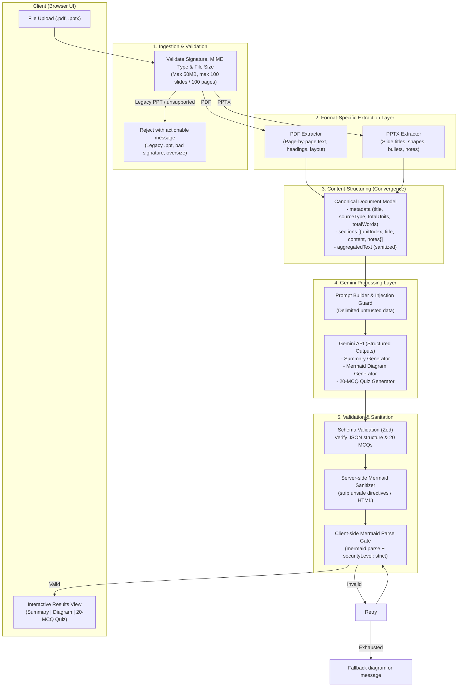

# Architecture: Unified Document-Processing Pipeline

## 1. Overview & Goals

This project provides an AI-powered study assistant for students and educators. It processes study materials—supporting **PDF** documents and **PowerPoint (.pptx)** presentations—into:
1. **Structured Summaries** (TL;DR, key points, slide/section breakdowns).
2. **Conceptual Visual Diagrams** (Rendered Mermaid.js diagrams).
3. **Interactive 20-Question MCQ Quizzes** (With answer keys and educational explanations).

### Core Architectural Principle: Unified Pipeline
While PDF and PPT/PPTX files have distinct binary/archive formats and extraction requirements, they converge into a single **Canonical Document Representation**. From that point forward, all downstream stages—prompt assembly, Gemini LLM calls, output validation, and frontend rendering—operate on a shared, unified pipeline.

---

## 2. Pipeline Architecture & Data Flow



---

## 3. Pipeline Stages in Detail

### Stage 1: Ingestion & File Validation
- **Supported Input Types**: `application/pdf` and `application/vnd.openxmlformats-officedocument.presentationml.presentation` (`.pdf`, `.pptx`).
- **Out of Scope**: Legacy binary `.ppt` (OLE2/CFB). It has no reliable pure-JS parser, so it is rejected at ingestion with an actionable "re-save as `.pptx` or PDF" message rather than being parsed incorrectly.
- **Pre-flight Checks**:
  - Magic number / signature validation (prevent renamed malicious files).
  - Extension and declared MIME type agreement (a `.pdf` extension with a ZIP signature is rejected).
  - Size limitation (maximum 50MB).
  - Scope boundaries (reject files exceeding 100 slides or 100 pages with an actionable message).

### Stage 2: Separate Extraction Components
Because PDF is page-based with arbitrary coordinate streams, and PPTX is an OpenXML archive of slides, extraction is separated into dedicated extractors:

1. **PDF Extractor**:
   - Extracts text page-by-page.
   - Extracts page count, document metadata, and structural headers.
   - Strips empty pages and extracts readable tables/paragraphs.
   - *Tools*: Node (`pdfjs-dist`).

2. **PowerPoint Extractor**:
   - Parses slides sequentially.
   - Extracts slide titles, body text frames, bullet hierarchy, tables, and speaker notes.
   - Retains slide numbering for accurate citations in the summary.
   - *Tools*: Node (`jszip` + `fast-xml-parser`, reading the OpenXML slide parts directly).

### Stage 3: Content-Structuring (Convergence)
Both extractors output the **Canonical Document Representation**:

```typescript
interface CanonicalDocument {
  metadata: {
    title: string;
    sourceType: 'pdf' | 'pptx';
    totalUnits: number; // pages or slides
    totalWords: number;
  };
  sections: Array<{
    unitIndex: number; // page number or slide number (1-indexed)
    title?: string;
    content: string;
    notes?: string;
  }>;
  aggregatedText: string;
}
```

### Stage 4: Gemini LLM Processing Layer
- **Prompt Isolation**: Untrusted document content is passed in strictly delimited tags (`<document_content>...</document_content>`) with system instructions stating content must never be executed as instructions.
- **Structured Outputs**: Uses Gemini’s native JSON Schema mode (`response_mime_type: "application/json"`) to ensure strictly formatted responses containing:
  1. `summary`: `{ tldr: string, keyTakeaways: string[], sectionBreakdowns: [{ sectionIndex, title, summary }] }`
  2. `diagram`: `{ mermaidCode: string, diagramType: string, explanation: string }`
  3. `quiz`: Array of exactly 20 items: `[{ id, question, options: [string, string, string, string], correctIndex: number, explanation: string }]`

### Stage 5: Validation & Post-Processing
1. **Schema Validation**: Validates the payload using Zod. Ensures that `quiz` has exactly 20 valid questions with valid `correctIndex` (0–3) and exactly four non-empty options each.
2. **Mermaid Sanitization (server-side)**: Rejects or strips risky constructs (raw HTML tags, `script`/`style` blocks, `javascript:` URLs, `%%{init:...}%%` directives, `click`/`href` handlers) and enforces a maximum code length, before the code ever reaches the client.
3. **Mermaid Parse Gate (client-side)**: `mermaid.parse()` must succeed before rendering, and rendering always uses `securityLevel: 'strict'` with `htmlLabels: false`.
4. **Graceful Fallback**: If a diagram fails validation or parsing, one targeted Gemini correction is attempted; if that also fails, a safe fallback outline diagram is supplied instead of failing the entire request.

### Stage 6: Client Delivery & UI
- **Summary Tab**: Clean, modern cards for TL;DR, high-level takeaways, and expandable section details.
- **Diagram Tab**: Live-rendered SVG via Mermaid.js with pan/zoom controls and raw syntax export.
- **Interactive Quiz Tab**:
  - Student mode: one question at a time or full view, instant option selection, score calculation, and explanations for incorrect answers.

**Rendering policy**: all AI-generated text is rendered as plain React text nodes (no markdown/HTML library), which makes XSS structurally impossible and removes the need for an HTML sanitiser. Only Mermaid output is rendered as SVG, and only after sanitisation plus the client-side parse gate.

---

## 4. Security Architecture

1. **Untrusted Data Isolation**: All extracted text from PDFs and PPTX presentations is treated as untrusted user input to prevent prompt injection.
2. **Secret Management**: Google Gemini API keys are kept strictly on the backend/server-side and accessed via environment variables (`.env`). No keys are exposed to client bundles.
3. **Safe Rendering**: AI-generated text is rendered as plain text nodes (no HTML sink), and Mermaid output is sanitized server-side and gated by a client-side parse gate before rendering, preventing Cross-Site Scripting (XSS).

---

## 5. Technology Stack Recommendations

| Layer | Recommended Stack | Rationale |
| :--- | :--- | :--- |
| **Frontend UI** | Next.js + TypeScript + Tailwind CSS v4 | Fast rendering, strong type-safety, modern responsive utility styling, SSR/client components for interactive quiz and diagrams. |
| **Document Parsers** | Next.js API Routes (Node runtime) | `pdfjs-dist` for PDF and `jszip` + `fast-xml-parser` for PPTX keep parsing inside the same repository and runtime as the app; no Python service to deploy. |
| **LLM Provider** | Google Gemini 2.5 Flash via `@google/genai` | Long context window (handles multi-page documents), fast inference, structured JSON output mode. Server-side only. |
| **Diagram Engine** | `mermaid.js` | Industry standard for code-to-diagram rendering in browser. |
| **Validation** | `zod` | Strict runtime typing and JSON schema enforcement. |
| **Testing** | `vitest` + `@playwright/test` | Fast deterministic unit/integration tests plus real browser end-to-end coverage. |
