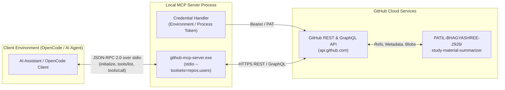

# GitHub MCP Server Integration

## 1. Overview & Objective

This document outlines the architecture, local server configuration, authentication model, tool inventory, and verification results for integrating the official GitHub Model Context Protocol (MCP) server with OpenCode and AI agent workflows for the repository [`PATIL-BHAGYASHREE-2926/study-material-summarizer`](https://github.com/PATIL-BHAGYASHREE-2926/study-material-summarizer).

The integration allows development agents to inspect repository state, read files, list branches, and perform scoped git operations via a standardized, secure Model Context Protocol interface.

---

## 2. Architecture & Data Flow

Communication between the AI client / OpenCode environment and GitHub is mediated by a local MCP server process running over standard I/O (`stdio`) using JSON-RPC 2.0.



### Architectural Principles
1. **Process Isolation**: The MCP server runs as a separate native subprocess, isolating git protocol handling and GitHub REST requests from the agent runtime.
2. **Standard Protocol**: Interactions adhere strictly to the MCP specification (`protocolVersion: "2024-11-05"`), using JSON-RPC requests (`initialize`, `tools/list`, `tools/call`) and notifications (`notifications/initialized`).
3. **Least Privilege Toolsets**: The server is spawned with `--toolsets=repos,users`, exposing repository and user facilities while withholding administrative, billing, and organizational management endpoints.

---

## 3. Local Server Setup

### 3.1 Binary Installation
- **Binary**: Official GitHub MCP Server Windows x86_64 executable (`github-mcp-server.exe`).
- **Binary Location**: Local executable path (e.g. `D:\github-mcp-server_Windows_x86_64\github-mcp-server.exe`).
- **Command Arguments**:
  ```bash
  github-mcp-server.exe stdio --toolsets=repos,users
  ```

### 3.2 OpenCode Configuration
OpenCode registers the MCP server in the user configuration file (`~/.config/opencode/opencode.jsonc`):

```jsonc
{
  "$schema": "https://opencode.ai/config.json",
  "mcp": {
    "github": {
      "type": "local",
      "command": [
        "D:\\github-mcp-server_Windows_x86_64\\github-mcp-server.exe",
        "stdio",
        "--toolsets=repos,users"
      ],
      "enabled": true
    }
  }
}
```

---

## 4. Authentication & Secret Management

### 4.1 Token Requirements
The server requires a GitHub Personal Access Token (classic or fine-grained) with access to the target repository:
- **Repository Permissions**:
  - Contents: Read & write (for reading files and creating branches/commits)
  - Metadata: Read-only (for repository identification)

### 4.2 Credential Isolation Guardrails
- **No In-Tree Secrets**: Personal access tokens are never committed to git, never added to repository files, and never referenced in code documentation.
- **Ignored Files**: Project `.gitignore` excludes local environment files (`.env`, `.env.local`), and repository-level OpenCode permissions (`opencode.json`) enforce read blocks (`"deny"`) on `.env` files.
- **Environment Injection**: The MCP process reads credentials exclusively from the user environment (`GITHUB_PERSONAL_ACCESS_TOKEN` or `GITHUB_TOKEN`) or a secure user-level configuration path outside the repository workspace.

---

## 5. Tool Inventory (`--toolsets=repos,users`)

When initialized with `--toolsets=repos,users`, the server exposes **20 distinct tools**:

| Tool Name | Type | Description |
| :--- | :--- | :--- |
| `search_repositories` | Query | Search repositories by query, topics, or exact repository identifiers. |
| `get_file_contents` | Read | Retrieve file contents or directory file listings for a repository path. |
| `list_branches` | Read | List branches with commit SHAs and protection statuses. |
| `get_commit` | Read | Fetch details for a specific commit SHA. |
| `list_commits` | Read | Retrieve paginated commit history for a branch. |
| `list_tags` | Read | List git tags in a repository. |
| `get_tag` | Read | Get details of a specific git tag. |
| `list_releases` | Read | Retrieve releases created in the repository. |
| `get_latest_release` | Read | Fetch the latest release metadata. |
| `get_release_by_tag` | Read | Fetch a specific release by tag name. |
| `list_repository_collaborators` | Read | List collaborators with access permissions. |
| `search_code` | Query | Native code search across repositories. |
| `search_commits` | Query | Search commit messages and metadata. |
| `search_users` | Query | Search GitHub users and profile metadata. |
| `create_branch` | Write | Create a new git branch from an existing reference. |
| `create_repository` | Write | Create a new repository in user/organization namespace. |
| `fork_repository` | Write | Fork a repository to an account or organization. |
| `create_or_update_file` | Write | Create or update a single file with commit message. |
| `delete_file` | Write | Delete a single file with commit message. |
| `push_files` | Write | Commit and push multiple files in an atomic commit. |

---

## 6. Verification Results: Verified Operations vs. Untested Capabilities

To ensure rigor and transparency, operations are categorized into **verified operations** (directly tested against the live repository) and **untested capabilities** (supported by the server schema but deliberately not executed).

### 6.1 Verified Operations

| Operation | Tool Used | Input Arguments | Output / Observed Result | Verification Status |
| :--- | :--- | :--- | :--- | :--- |
| **MCP Protocol Handshake** | `initialize`<br>`tools/list` | `protocolVersion: "2024-11-05"` | Server responded with capabilities and 20 tool definitions. | **VERIFIED** |
| **Repository Discovery & Metadata** | `search_repositories` | `query: "repo:PATIL-BHAGYASHREE-2926/study-material-summarizer"`<br>`minimal_output: false` | Returned repository object: public visibility, TypeScript language, default branch `main`, admin/push/pull permissions. | **VERIFIED** |
| **Root Directory File Listing** | `get_file_contents` | `owner: "PATIL-BHAGYASHREE-2926"`<br>`repo: "study-material-summarizer"`<br>`path: ""` | Listed all 20 root files/directories including `package.json`, `ARCHITECTURE.md`, `AGENTS.md`, and `src/`. | **VERIFIED** |
| **Default Branch Inspection** | `list_branches` | `owner: "PATIL-BHAGYASHREE-2926"`<br>`repo: "study-material-summarizer"` | Confirmed `main` branch with HEAD commit SHA `2d0bf96ee9bf452489615233234d6e4b3864e29f`. | **VERIFIED** |
| **Branch Creation (Write Operation)** | `create_branch` | `owner: "PATIL-BHAGYASHREE-2926"`<br>`repo: "study-material-summarizer"`<br>`branch: "mcp-write-verification"`<br>`from_branch: "main"` | Successfully created `refs/heads/mcp-write-verification` pointing to SHA `2d0bf96ee9bf452489615233234d6e4b3864e29f` (HTTP 201). | **VERIFIED** |
| **Branch Persistence Verification** | `list_branches` | `owner: "PATIL-BHAGYASHREE-2926"`<br>`repo: "study-material-summarizer"` | Returned both branches (`main` and `mcp-write-verification`) referencing identical HEAD SHA. | **VERIFIED** |

### 6.2 Untested Capabilities
The following tools are available in the toolset but were **intentionally not invoked** during verification to guarantee zero modification to production code:

- `create_or_update_file`: Untested in this verification. No application files were created or modified.
- `push_files`: Untested in this verification. No multi-file commits were pushed.
- `delete_file`: Untested in this verification. No repository files were removed.
- `fork_repository` & `create_repository`: Untested.
- `search_code`, `search_commits`, `list_commits`, `get_commit`: Untested in this phase.

---

## 7. Security Precautions & Guardrails

1. **Non-Destructive Testing**: All tests were executed in an isolated manner. File-writing and multi-file push operations were withheld.
2. **Branch Isolation**: The write verification created a dedicated test branch (`mcp-write-verification`) from `main` without creating pull requests, merges, or branch protection modifications.
3. **Workspace Protection**: No modifications were made to project source files (`src/*`), configuration (`tsconfig.json`, `next.config.ts`), or dependencies (`package.json`).
4. **Secret Shielding**: Personal access tokens were kept out of terminal outputs, command strings, and documentation artifacts.

---

## 8. Limitations & Known Considerations

1. **Authentication Scope**: If credentials lack the `repo` scope or expire, the server returns `401 Bad credentials` on all authenticated GitHub REST calls.
2. **Search Rate Limits**: Calls to `search_repositories` utilize GitHub's search rate limit quota (30 requests per minute for authenticated users). Broad queries should be avoided in favor of direct endpoint queries.
3. **Toolset Constraints**: Operating with `--toolsets=repos,users` intentionally omits pull request (`pull_requests`), issue tracking (`issues`), workflow dispatch (`actions`), and discussion management tools. Expanding capabilities requires updating the `--toolsets` flag in the OpenCode configuration.

---

## 9. Steps to Reproduce Verification Tests

### Step 1: Confirm MCP Server Registration
Run the OpenCode MCP status command:
```bash
opencode mcp list
```
**Expected Output**:
```text
┌  MCP Servers
│
●  ✓ github connected
│      D:\github-mcp-server_Windows_x86_64\github-mcp-server.exe stdio --toolsets=repos,users
└  1 server(s)
```

### Step 2: Initialize MCP Session
Send an MCP `initialize` request via stdio:
```json
{
  "jsonrpc": "2.0",
  "id": 1,
  "method": "initialize",
  "params": {
    "protocolVersion": "2024-11-05",
    "capabilities": {},
    "clientInfo": { "name": "verification-client", "version": "1.0.0" }
  }
}
```
Send the `notifications/initialized` notification upon receiving the response.

### Step 3: Inspect Repository Metadata
Send a `tools/call` request for `search_repositories`:
```json
{
  "jsonrpc": "2.0",
  "id": 2,
  "method": "tools/call",
  "params": {
    "name": "search_repositories",
    "arguments": {
      "query": "repo:PATIL-BHAGYASHREE-2926/study-material-summarizer",
      "minimal_output": false
    }
  }
}
```
**Verification**: Response contains repository metadata object with `default_branch: "main"`.

### Step 4: List Root Files
Send a `tools/call` request for `get_file_contents`:
```json
{
  "jsonrpc": "2.0",
  "id": 3,
  "method": "tools/call",
  "params": {
    "name": "get_file_contents",
    "arguments": {
      "owner": "PATIL-BHAGYASHREE-2926",
      "repo": "study-material-summarizer",
      "path": ""
    }
  }
}
```
**Verification**: Response contains directory entries including `package.json`, `ARCHITECTURE.md`, `src`, and `tests`.

### Step 5: Test Branch Creation & Verification
Send a `tools/call` request for `create_branch`:
```json
{
  "jsonrpc": "2.0",
  "id": 4,
  "method": "tools/call",
  "params": {
    "name": "create_branch",
    "arguments": {
      "owner": "PATIL-BHAGYASHREE-2926",
      "repo": "study-material-summarizer",
      "branch": "mcp-write-verification",
      "from_branch": "main"
    }
  }
}
```
**Verification**: Response confirms creation of `refs/heads/mcp-write-verification`.

Confirm using `list_branches`:
```json
{
  "jsonrpc": "2.0",
  "id": 5,
  "method": "tools/call",
  "params": {
    "name": "list_branches",
    "arguments": {
      "owner": "PATIL-BHAGYASHREE-2926",
      "repo": "study-material-summarizer"
    }
  }
}
```
**Verification**: Response contains both `main` and `mcp-write-verification`.
